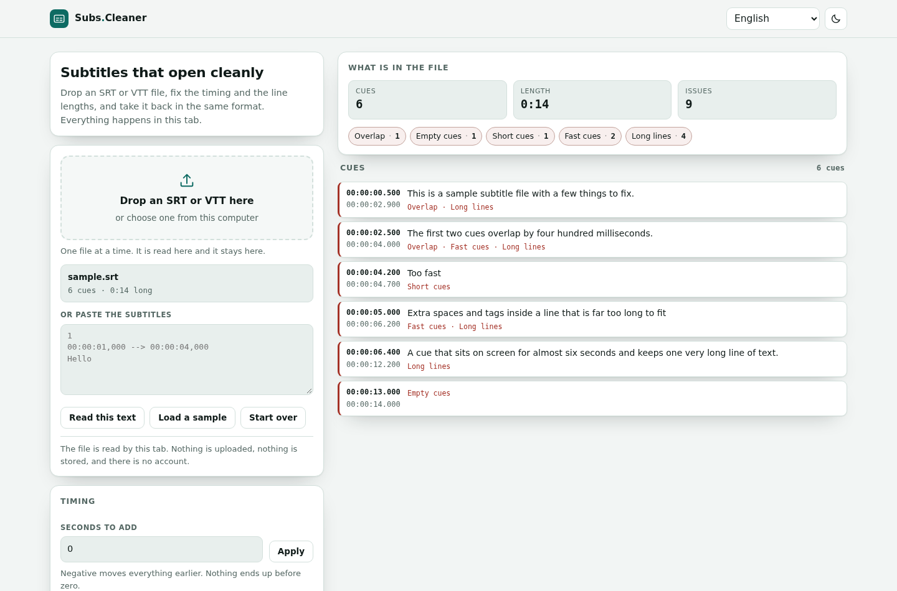

# Subtitle Cleaner

**An SRT or VTT that opens cleanly, fixed inside the tab.**

[](https://tekideki.github.io/Subtitle-Cleaner/)
[](LICENSE)



Drop a subtitle file, move the timing, repair the cues that step on each other, re-wrap the lines that run off the screen, and take the file back in SRT or VTT.

The file is read by the page itself. No account, no upload, no queue, and nothing is kept after the tab is closed.

## What it does

- **SRT and VTT, both ways.** Either format goes in and either format comes out, with the times converted as they go.
- **A shift in seconds.** Move the whole file later or earlier. A negative shift stops at zero instead of writing times that cannot exist.
- **A speed match.** Type `1.25` when the video was sped up to 125 percent, and the subtitles are retimed to keep up.
- **Overlaps repaired.** The cue that ends too late is cut where the next one starts. If cutting would leave it under eight tenths of a second, it is left alone and the page says so.
- **Long cues split.** A cue that cannot fit in two lines is cut into pieces that share its time, the way a subtitle editor would do it.
- **Lines re-wrapped.** Join the lines, then break them again under the character limit that is typed in the box.
- **Tags stripped.** `<i>`, `<font color>` and ASS blocks such as `{\an8}` go away when the player does not want them.
- **A report before the export.** Empty cues, cues that end before they start, cues over seven seconds, cues faster than twenty one characters a second, lines over the limit, and cues with too many lines, with a count for each one.
- **Four languages.** English, Romanian, Serbian Latin and Serbian Cyrillic, with the counting done the way each language counts.
- **Dark theme, installable, offline.** One HTML file holds the whole thing.

## How to use it

1. Drop an SRT or VTT on the page, choose one from the disk, or paste the text.
2. Read the report on the right. Every chip is a problem with its count.
3. Fix what is there: **Fix overlaps**, **Clean the text**, **Re-wrap the lines**, **Split long cues**, **Strip tags**, **Sort by time**.
4. Move the timing if the subtitles came from a different release of the video.
5. Pick SRT or VTT, then **Download** or **Copy**.

## Why it is built this way

**Nothing leaves the tab.** `index.html` carries the parser, the repairs and the writer. The browser test fails if a single request leaves the local server, so "no upload" is a property that is checked, not a promise.

**Old files still open.** A subtitle downloaded in this part of the world is often saved in the old Windows encoding, which is not UTF-8. The bytes are read as UTF-8 first, and if that fails the file is decoded as Windows-1250, so a Romanian or Serbian letter survives the trip.

**The repairs are checked on the output, not on the screen.** The browser test presses a button, then reads the file that the download button produced and compares its timecodes with the cues on the page. A repair that only looks right in the list would fail.

**Deterministic build.** `python3 build.py` inlines the styles, the model, the messages into `index.html`, and transliterates Serbian Cyrillic so it cannot drift from the Latin version. No timestamps, no machine paths, no em dash, no byte order mark; the build refuses all of them.

**One honest limit.** This fixes the file; it does not translate it and it does not burn it into a video. Those are different jobs.

## Tests

```bash
node tests/logic_test.cjs          # 123 checks: stamps, parsing, the audit, every repair
python3 tests/ui_test.py           # 69 checks in Chromium, server included
```

The logic test walks the awkward cases: a cue without its number, a header that is not a cue, a broken stamp, a shift below zero, a run of three overlapping cues, a word longer than the line limit.

The browser test loads the sample, presses every repair, downloads the result in both formats, reads it back, uploads files saved as UTF-8 and as Windows-1250, pastes four hundred and fifty cues, and fails on any console error or foreign request.

## Development

```bash
python3 build.py                   # writes index.html from src/
python3 -m http.server 8000        # then open http://localhost:8000
```

Sources live in `src/`: `model.js` (parsing, the audit, the repairs), `app.js` (the page), `styles.css`, `template.html`, `i18n/locales.json` (en, ro, sr-latn). The Cyrillic locale is generated by the build, never edited by hand.

## Licence

Apache 2.0. See `LICENSE`. Every tool here is free and stays free.
